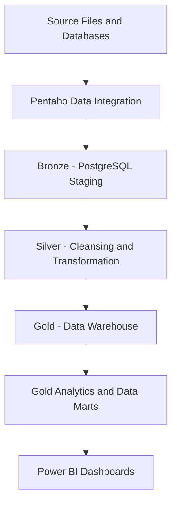

# Source-to-Target Mapping
## Enterprise Insurance Data Platform

### 1. Purpose

This document describes how data moves from source files and databases into PostgreSQL staging tables, through data cleansing and transformation, into the Gold data warehouse, and finally into analytical views and Power BI dashboards.

It provides a reference for source systems, target tables, transformation activities, and data lineage.

### 2. Source-to-Target Architecture

**Note:** This diagram represents the intended architecture. Each individual path must be verified against the actual Pentaho transformations, SQL definitions, and Power BI configuration.

### 3. Source-to-Bronze Mapping

| Source File or System | Source Format | PostgreSQL Target | Description |
|---|---|---|---|
| `cust_demographics.csv` | CSV | `stg.stg_customer` | Customer demographic information |
| `claims.csv` | CSV | `stg.stg_claim_details` | Claim identifiers, incident information, and claim dates |
| Auto insurance Excel source | Excel | `stg.stg_auto_insurance` | Auto insurance records |
| Underwriting dataset | JSON | Target table to be confirmed | Age, sex, BMI, children, smoker status, region, and charges |
| SQL source tables | SQL | Target table to be confirmed | Structured relational data |

The CSV and Excel staging targets above were identified during project implementation. The exact underwriting target table and SQL-source mappings must be confirmed.

### 4. Source Column Mapping

#### 4.1 Customer Demographics

| Source Column | Description | Target Table |
|---|---|---|
| `CUST_ID` | Customer identifier | `stg.stg_customer` |
| `gender` | Customer gender | `stg.stg_customer` |
| `DateOfBirth` | Customer date of birth | `stg.stg_customer` |
| `State` | Customer state | `stg.stg_customer` |
| `Contact` | Customer contact information | `stg.stg_customer` |
| `Segment` | Customer segment | `stg.stg_customer` |

The exact target column names and any field renaming should be checked against the staging table definition.

#### 4.2 Claims Data

| Source Column | Description | Target Table |
|---|---|---|
| `claim_id` | Claim identifier | `stg.stg_claim_details` |
| `customer_id` | Related customer identifier | `stg.stg_claim_details` |
| `incident_cause` | Cause of incident | `stg.stg_claim_details` |
| `claim_date` | Date of claim | `stg.stg_claim_details` |
| `claim_area` | Claim area | `stg.stg_claim_details` |

#### 4.3 Auto Insurance Data

The auto insurance Excel source is loaded into `stg.stg_auto_insurance`.

The detailed source-to-target column mapping should be recorded after checking the Excel column names and the target table definition.

#### 4.4 Underwriting Data

The underwriting JSON source contains fields including:

- `age`
- `sex`
- `bmi`
- `children`
- `smoker`
- `region`
- `charges`

The final PostgreSQL target table and its column mappings must be verified before marking this mapping as complete.

### 5. Silver-Layer Mapping

The Silver layer is intended to contain cleaned, standardized, transformed, and validated data.

| Input | Processing Activities | Target |
|---|---|---|
| `stg.stg_customer` | Standardize text, handle missing values, validate customer identifiers and dates | Silver target to be confirmed |
| `stg.stg_claim_details` | Standardize claim fields, validate dates and identifiers | Silver target to be confirmed |
| `stg.stg_auto_insurance` | Standardize field formats and validate insurance records | Silver target to be confirmed |
| Underwriting staging data | Validate numeric and categorical fields | Target to be confirmed |

Pentaho Data Integration is used for ETL processing in this project. Actual transformation names, output tables, and validation rules must be documented from the implemented `.ktr` and `.kjb` files.

Separate SQL scripts should be documented here only when SQL-based Silver processing is actually implemented.

### 6. Gold Warehouse Mapping

The Gold warehouse uses the PostgreSQL `dw` schema.

#### 6.1 Dimension Tables

| Target Table | Purpose | Known Attributes |
|---|---|---|
| `dw.dim_customer` | Customer dimension | Customer ID, date of birth, gender, state, contact, segment |
| `dw.dim_date` | Date dimension | Full date, day, month, month name, quarter, year |
| `dw.dim_policy` | Policy dimension | Policy number, bind date, policy state, CSL, deductible, annual premium, umbrella limit, months as customer |
| `dw.dim_vehicle` | Vehicle dimension | Auto make, model, year |

#### 6.2 Fact Tables

| Target Table | Purpose | Lineage Status |
|---|---|---|
| `dw.fact_claim` | Claim-related analysis | Exact source mapping and measures to be verified |
| `dw.fact_insurance_claim` | Insurance claim analysis | Exact source mapping and foreign keys to be verified |
| `dw.fact_premium_loss` | Premium, loss, and tax analysis | Table columns identified; exact source mapping to be verified |

The exact source-to-target relationships, fact-table grain, key generation, and transformation rules must be checked against the PostgreSQL table definitions and ETL logic.

### 7. Gold Analytics and Data-Mart Mapping

| Gold Object | Main Outputs | Purpose |
|---|---|---|
| `gold.claims_analytics` | Claim type, fraud indicator, total claim records, unique customers, total and average claim amounts | Claims analysis |
| `gold.customer_analytics` | Total customer records, unique customers, total claim records, customers with claims | Customer analysis |
| `gold.health_insurance_analytics` | Reporting year, state, insurance company, record count, premiums, losses, taxes | Health insurance-related analysis |
| `gold.premium_loss_analytics` | Premiums written, losses paid, taxes, and loss ratio | Premium and loss analysis |
| `gold.claims_datamart` | Claim summary by claim type and fraud indicator | Claims reporting |
| `gold.customer_datamart` | Customer summary and percentage of customers with claims | Customer reporting |

The first three analytics views were identified in PostgreSQL. The premium/loss and additional data-mart views must be verified in PostgreSQL before being marked as implemented.

The actual SQL definitions determine which source tables feed each Gold object. Those definitions should be checked to establish precise lineage.

### 8. Power BI Reporting Mapping

Power BI connects to the `insurance_dw` PostgreSQL database.

The reported data model contains:

- `dw.dim_customer`
- `dw.dim_date`
- `dw.dim_policy`
- `dw.dim_vehicle`
- `dw.fact_claim`
- `dw.fact_insurance_claim`
- `dw.fact_premium_loss`

These tables support insurance reporting and dashboard analysis.

For full report lineage, document the source table or view, measure, relationships, and filters used by each Power BI visual.

### 9. Data Quality and Validation

Data quality is addressed through ingestion checks, cleansing, transformation, and validation.

| Stage | Validation Activities |
|---|---|
| Source ingestion | Check file format, headers, field types, and load errors |
| Bronze staging | Check record counts, required fields, and ingestion failures |
| Silver processing | Validate identifiers, dates, missing values, duplicates, and business rules |
| Gold warehouse | Validate keys, relationships, and analytical measures |
| Reporting | Check aggregations, filters, and consistency of business metrics |

The actual validation rules and error-handling steps should be recorded from the implemented Pentaho transformations and SQL scripts.

### 10. Lineage Verification Checklist

- [ ] Confirm the exact source filename and source column names.
- [ ] Record the Pentaho transformation or job used for each source.
- [ ] Confirm all Bronze staging table names and column mappings.
- [ ] Identify the implemented Silver target tables and processing rules.
- [ ] Verify the source mappings and keys for all Gold dimension and fact tables.
- [ ] Confirm the SQL definitions of Gold analytics views and data marts.
- [ ] Verify the data sources and measures used by Power BI dashboards.
- [ ] Document logging, rejected-row handling, and error recovery.
- [ ] Update this document whenever a source, transformation, table, view, or reporting model changes.

### 11. Conclusion

This source-to-target mapping provides a structured reference for understanding how insurance data moves through ingestion, staging, transformation, warehousing, analytics, and reporting.

Maintaining verified source-to-target mappings improves traceability, supports data-quality investigations, and helps ensure that analytical results can be traced back to their originating data.
