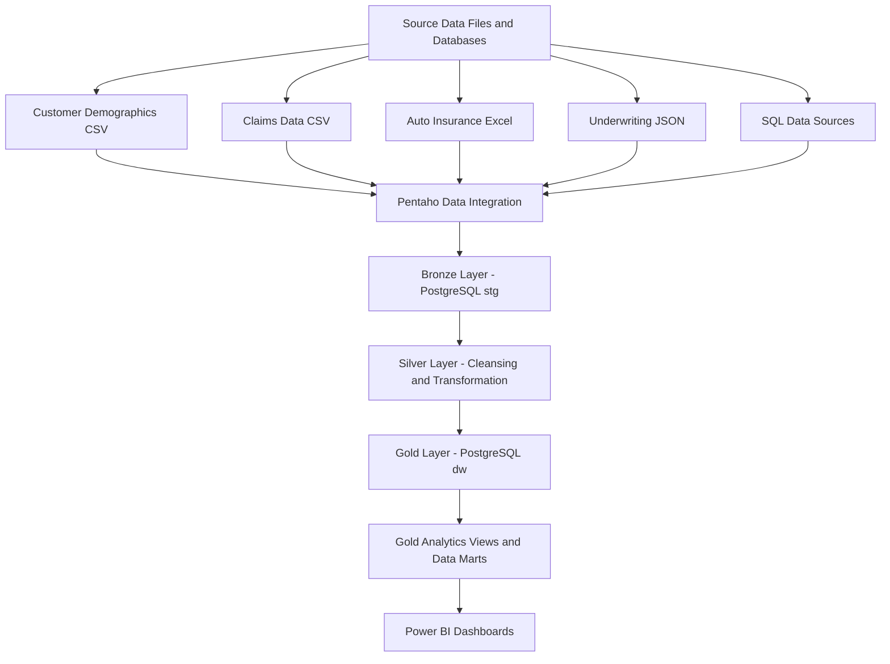

# Data Lineage Documentation
## Enterprise Insurance Data Platform

### 1. Purpose

This document describes the flow of data through the Enterprise Insurance Data Platform, from source systems to reporting dashboards. It identifies the main processing stages, technologies, database schemas, transformations, and reporting outputs.

The platform follows a Bronze–Silver–Gold architecture to organize raw data, data-quality processing, analytical warehouse tables, and business reporting.

### 2. Data Lineage Architecture

**Implementation note:** The diagram represents the intended end-to-end architecture. The precise source-to-target mapping and execution path must be verified against the actual Pentaho transformations, SQL definitions, and Power BI connections.

### 3. Source Data Layer

The platform uses multiple source formats to demonstrate data ingestion and integration.

| Source | Format | Purpose |
|---|---|---|
| Customer demographics | CSV | Customer attributes and demographic information |
| Claims data | CSV | Claim identifiers, incident information, and claim dates |
| Auto insurance | Excel | Auto insurance records |
| Underwriting data | JSON | Age, sex, BMI, children, smoker status, region, and charges |
| SQL source data | Relational tables | Structured data ingestion |

The source files are processed through Pentaho Data Integration before loading into PostgreSQL staging tables.

### 4. Bronze Layer — Raw Data and Staging

**Database:** `insurance_dw`  
**Schema:** `stg`

The Bronze layer stores ingested source data in staging tables. It provides a structured landing area for data received from different source formats.

Known staging tables include:

- `stg.stg_customer`
- `stg.stg_claim_details`
- `stg.stg_auto_insurance`

The underwriting JSON source was also ingested through Pentaho, but its final target table should be confirmed before documenting a table-level lineage path.

Typical operations include source extraction, field mapping, initial type conversion, and loading into PostgreSQL.

The Bronze layer should preserve source information as far as the ingestion design allows. Whether the current staging tables preserve every original field and value must be verified.

### 5. Silver Layer — Cleansing and Transformation

The Silver layer is intended to contain cleaned, standardized, and validated data suitable for integration and analysis.

Typical processing activities include:

- Removing unnecessary spaces and standardizing text.
- Handling missing or invalid values.
- Standardizing dates, numeric fields, and identifiers.
- Checking duplicate records and key consistency.
- Validating required fields and business rules.
- Integrating related records using common identifiers.

Pentaho Data Integration is used for ETL processing in this project. SQL scripts may also be used for database-side transformations where applicable.

**Implementation status:** The existence of the `sql/silver/cleansing/`, `sql/silver/transformations/`, and `sql/silver/validation/` folders does not itself confirm that separate Silver SQL pipelines or Silver tables have been implemented. Actual transformation steps and target tables should be recorded from the existing Pentaho and PostgreSQL configuration.

### 6. Gold Layer — Data Warehouse

**Database:** `insurance_dw`  
**Schema:** `dw`

The Gold warehouse contains dimension and fact tables used for analytical reporting.

#### 6.1 Dimension Tables

| Table | Purpose |
|---|---|
| `dw.dim_customer` | Customer identifiers and demographic attributes |
| `dw.dim_date` | Calendar attributes for time-based analysis |
| `dw.dim_policy` | Policy attributes and policy-related information |
| `dw.dim_vehicle` | Vehicle make, model, and year |

#### 6.2 Fact Tables

| Table | Intended analytical purpose |
|---|---|
| `dw.fact_claim` | Claim-related measures and records |
| `dw.fact_insurance_claim` | Insurance claim analysis |
| `dw.fact_premium_loss` | Premiums written, losses paid, taxes, and related records |

The exact measures, foreign keys, and grain of each fact table should be documented from the actual table definitions. The table names alone do not establish their complete relationships.

### 7. Gold Analytics Views and Data Marts

The Gold schema contains business-oriented views that summarize warehouse data for analysis.

| View | Purpose |
|---|---|
| `gold.claims_analytics` | Claim counts, unique customers, total claim amounts, average claim amounts, and fraud categories |
| `gold.customer_analytics` | Customer counts and customer participation in claims |
| `gold.health_insurance_analytics` | Premium, loss, and tax summaries by reporting year, state, and insurance company |
| `gold.premium_loss_analytics` | Intended premium and loss analysis by year, state, company, and record description |
| `gold.claims_datamart` | Intended claim summary grouped by claim type and fraud indicator |
| `gold.customer_datamart` | Intended customer summary with the percentage of customers having claims |

The first three views were confirmed to exist in PostgreSQL. The remaining three views should be marked as implemented only after they have been created and verified.

The analytics and data-mart views should use consistent definitions and avoid duplicating the same calculations unnecessarily.

### 8. Reporting Layer — Power BI

Power BI connects to the PostgreSQL database and presents insurance data through interactive dashboards.

The configured reporting model includes the following warehouse tables:

- `dw.dim_customer`
- `dw.dim_date`
- `dw.dim_policy`
- `dw.dim_vehicle`
- `dw.fact_claim`
- `dw.fact_insurance_claim`
- `dw.fact_premium_loss`

The model uses relationships between dimensions and fact tables to support filtering and analysis.

Typical reporting areas include:

- Claim volume and claim amounts.
- Fraud-related claim analysis.
- Customer coverage and claims participation.
- Premiums written and losses paid.
- Insurance performance by company, state, and year.
- Vehicle and policy-related analysis where the relevant relationships and measures are available.

The exact Power BI visual-to-view lineage should be documented using the report's actual data sources and visual configurations.

### 9. Data Quality and Error Handling

Data quality is important at each stage of the pipeline.

| Stage | Data quality responsibility |
|---|---|
| Ingestion | Read source formats and handle extraction errors |
| Bronze | Identify ingestion failures and retain appropriate load information |
| Silver | Clean, standardize, validate, and integrate records |
| Gold warehouse | Maintain consistent keys, relationships, and analytical measures |
| Reporting | Validate aggregations, filters, and business metric definitions |

Pentaho transformations should be reviewed for logging, rejected-row handling, and error paths. The specific logging and exception-handling implementation should be documented from the actual transformation files.

### 10. Data Lineage and Traceability

For each source-to-target path, the project should maintain the following information:

| Lineage attribute | Description |
|---|---|
| Source system | Original file or database table |
| Source format | CSV, Excel, JSON, XML, or SQL |
| Ingestion transformation | Pentaho transformation or job name |
| Bronze target | PostgreSQL staging table |
| Silver processing | Cleansing, transformation, and validation steps |
| Gold target | Warehouse table or analytical view |
| Business purpose | Metric or report supported by the target |
| Validation method | SQL checks, Pentaho validation, or profiling |
| Execution status | Implemented, tested, or pending verification |

This information makes it possible to trace a reporting metric back to the data and transformations that produced it.

### 11. Limitations and Verification Requirements

Before treating the lineage as fully implemented, verify:

1. The exact source file and source-table mappings.
2. The Pentaho transformation and job responsible for each staging table.
3. The actual Silver target tables and processing steps.
4. The keys and relationships used to populate each Gold dimension and fact table.
5. The SQL definitions and current status of all Gold views and data marts.
6. The PostgreSQL objects used by each Power BI report and visual.
7. Logging, exception handling, and data-quality checks at each stage.

### 12. Conclusion

The Enterprise Insurance Data Platform organizes insurance data through source ingestion, PostgreSQL staging, data cleansing and transformation, a dimensional warehouse, Gold analytics views, and Power BI reporting.

This lineage documentation provides a common reference for understanding data movement, identifying processing responsibilities, and verifying the origin of analytical results. It should be updated whenever source systems, Pentaho transformations, database objects, or reporting models change.
